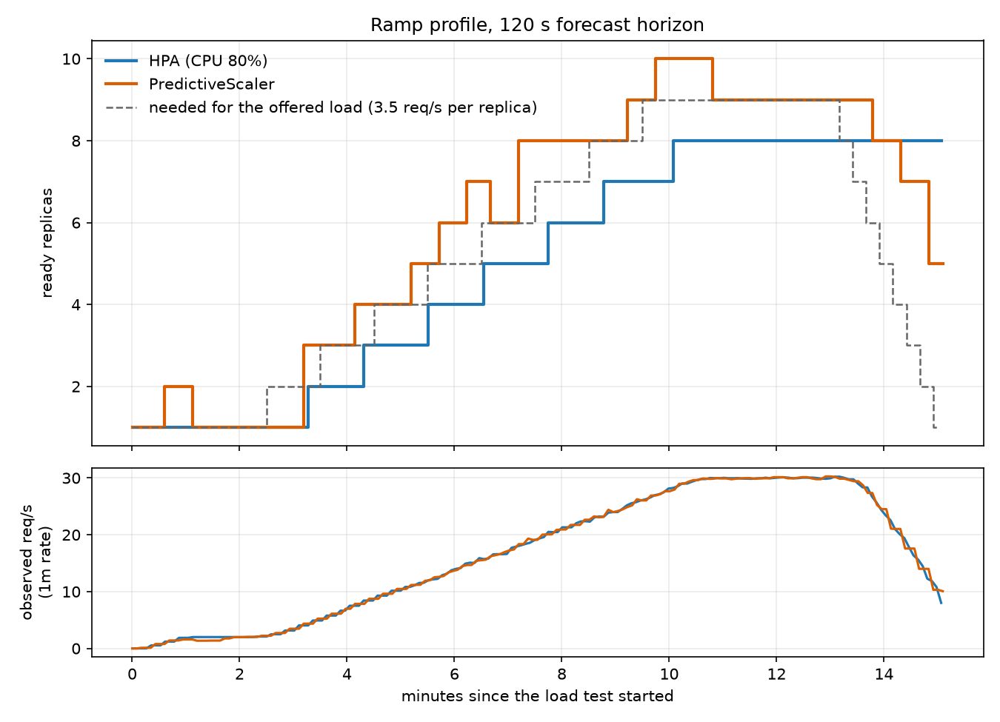

# Predictive Autoscaling Operator

A Kubernetes operator that scales a Deployment ahead of traffic instead of after it. You describe it with a `PredictiveScaler` resource. It reads request-rate history from Prometheus, forecasts a few minutes forward, and sets the replica count for the load that is coming.

## The problem

The standard Horizontal Pod Autoscaler is reactive. CPU crosses a threshold, the HPA notices, new pods get scheduled, and then they need time to start. When traffic climbs steadily you are always one step behind, and users feel the gap.

This project adds a `PredictiveScaler` resource to the cluster. You point it at a Deployment and a Prometheus query, and a controller keeps the replica count matched to the load it expects, not the load it just saw.

## How it works

```
Prometheus ──> forecaster ──> replica math ──> patch Deployment scale
 (last hour)    (+ confidence)   (min/max clamp)
                     │
                     └── low confidence: use current load instead
```

Every sync period, for each `PredictiveScaler`:

1. The controller runs your PromQL query over the last hour in 15 second steps.
2. A damped-trend Holt-Winters model (statsmodels) forecasts the load `forecastHorizonSeconds` ahead. A confidence score comes from how closely the fitted curve tracked the recent data.
3. If confidence is at or above `confidenceThreshold`, desired replicas is `ceil(max(forecast, current load) / requestsPerReplica)`. Below it, the same formula runs on the current load, so the operator behaves reactively instead of guessing.
4. The result is clamped to `[minReplicas, maxReplicas]` and written to the Deployment's `scale` subresource.
5. The forecast, confidence, chosen replica count and whether the fallback is active are written to the object's `status`.

### The resource

```yaml
apiVersion: autoscaling.predictive-operator.dev/v1alpha1
kind: PredictiveScaler
metadata:
  name: demo-app-scaler
  namespace: default
spec:
  targetDeployment: demo-app
  minReplicas: 1
  maxReplicas: 10
  metricQuery: 'sum(rate(demo_app_requests_total[1m]))'
  requestsPerReplica: 3.5
  forecastHorizonSeconds: 120
  confidenceThreshold: 0.6
  syncPeriodSeconds: 30
```

| Field | Meaning | Default |
|---|---|---|
| `targetDeployment` | Deployment to scale (same namespace) | required |
| `minReplicas` / `maxReplicas` | Hard bounds on the replica count | required |
| `metricQuery` | PromQL returning the load, e.g. requests per second | required |
| `requestsPerReplica` | Load one replica can handle | required |
| `forecastHorizonSeconds` | How far ahead to forecast (min 30). Longer adds capacity earlier at higher cost, see Results. The sample uses 120. | 300 |
| `confidenceThreshold` | Below this, fall back to current load (0 to 1) | 0.6 |
| `syncPeriodSeconds` | How often to re-evaluate (min 10) | 30 |

`kubectl get pscaler` shows the target, desired replicas, whether the fallback is active, and age.

`metricQuery` should be scoped to one workload. If it returns several series, the first one is used and a warning is logged.

## Design choices

**Kopf instead of kubebuilder.** Kopf is a Python operator framework, so the forecaster runs in the same process as the controller and there is no second service to deploy. kubebuilder (Go) is the more common choice on platform teams, but Go has no good time-series ecosystem, so it would need a separate Python forecasting service. Kopf is feature-complete and in maintenance mode, with regular releases (1.44.0 as of March 2026), which is fine for this scope.

**Holt-Winters instead of Prophet.** The forecast covers about five minutes, refit every sync period. Holt-Winters fits in milliseconds with no compiled dependency. Prophet is built for daily and yearly seasonality over long histories, which is a different problem. The trend is damped so a short burst isn't extrapolated into a huge replica count.

**A heuristic confidence score.** statsmodels doesn't give a cheap prediction interval for this model, and simulating one on every reconcile is too slow. Confidence is `1 - (residual std / mean load)`, clamped to 0 to 1. It is a measure of how well the model fits recent data, not a statistical guarantee.

**Least-privilege RBAC.** The ClusterRole covers only `predictivescalers`, `deployments/scale`, events, and read access to CRDs.

## Related work

This is not the first predictive autoscaler for Kubernetes. [predictive-horizontal-pod-autoscaler](https://github.com/jthomperoo/predictive-horizontal-pod-autoscaler) (Apache-2.0) extends the HPA with Holt-Winters and linear regression models and is installed with Helm. This project is a smaller, separate implementation: a Python operator built on Kopf that scales a Deployment through its scale subresource and falls back to current load when the forecast isn't trusted. It was built to learn the operator pattern and to measure the idea against the HPA, not to replace an established project.

## Requirements

- Docker, [kind](https://kind.sigs.k8s.io/), kubectl, Helm
- [k6](https://grafana.com/docs/k6/) (load tests only). If a k6 binary can't be installed or run, `K6_DOCKER=1` runs it from the `grafana/k6` image instead.
- Python 3.12 (running the tests)
- A bash shell. On Windows, use Git Bash or WSL2; the scripts won't run in PowerShell.

## Quick start

From the repo root:

```bash
./scripts/setup.sh
kubectl apply -f configs/sample-predictivescaler.yaml
kubectl get pscaler
```

`setup.sh` creates a kind cluster, installs the CRD, RBAC and Prometheus (Helm), builds the operator and demo app images, loads them into the cluster, and deploys both. It is safe to re-run. The demo app is reachable at `http://localhost:8080`.

Operator logs show each decision and the reason for it:

```bash
kubectl logs -n predictive-autoscaler-system deploy/predictive-autoscaler -f
```

### Operator settings

| Env var | Default |
|---|---|
| `PROMETHEUS_URL` | `http://prometheus-server.monitoring.svc:80` |
| `HISTORY_WINDOW_SECONDS` | `3600` |
| `METRIC_STEP_SECONDS` | `15` |

## Tests

```bash
pip install -e ".[dev]"
pytest
```

The tests need no cluster. They cover spec validation (including `maxReplicas < minReplicas`), the replica math (clamping, rounding up, the low-confidence fallback), forecaster edge cases (too little data, flat series, rising and falling trends), and the reconcile handler (a Prometheus outage or empty result leaves replicas untouched, and a healthy series scales).

## Load tests

Two traffic profiles, generated with k6 against the demo app:

- `ramp`: a steady climb from 2 to 30 requests per second, a hold, then a drop (15 minutes).
- `daily`: a compressed 24 hour pattern, one "hour" per 60 seconds (24 minutes).

The same profile is run against two controllers, one at a time: this operator, and a stock CPU-based HPA (`configs/hpa.yaml`, 80% target, default behavior).

```bash
load-tests/run.sh ramp predictive
load-tests/run.sh ramp hpa
load-tests/run.sh daily predictive
load-tests/run.sh daily hpa
```

For a fair comparison, each demo app request burns about 20 ms of CPU (22 ms measured including framework overhead), so CPU-based scaling has something to react to. The HPA target (80% of a 100m CPU request) and `requestsPerReplica: 3.5` both work out to roughly 3.5 requests per second per pod.

Each run removes both controllers, resets the demo app to one replica, enables the chosen one, warms up for two minutes, then records replica counts and request rate every 5 seconds. Everything goes to `load-tests/results/<label>-<profile>-<timestamp>/`:

- `replicas.csv`: spec replicas, ready replicas, observed requests per second over time
- `run-info.txt`: label, profile, peak rate, k6 and Kubernetes versions, and for predictive runs the `PredictiveScaler` spec that was applied
- `k6-summary.json` and `k6-output.txt`: k6's own output

## Forecast accuracy

The forecaster was evaluated offline on synthetic traffic that mirrors the two k6 profiles. The traffic is turned into what `sum(rate(...[1m]))` would report (Poisson request counts per 15 second scrape, averaged over the last minute). At every 30 second sync tick the forecaster predicts the load some seconds ahead, and the prediction is compared with what the metric showed at that time. It is scored against "persistence", which simply uses the current value, since that is what a purely reactive scaler effectively assumes.

Mean absolute error in requests per second, peak 30 rps, 20 seeds (mean, lower is better):

| Profile | Horizon | Persistence | Model | Model vs persistence |
|---|---|---|---|---|
| ramp | 30s | 1.65 | 0.84 | -49% |
| ramp | 60s | 3.03 | 1.91 | -37% |
| ramp | 120s | 5.46 | 3.60 | -34% |
| ramp | 300s | 13.37 | 10.01 | -25% |
| daily | 30s | 1.31 | 0.70 | -46% |
| daily | 60s | 2.50 | 1.62 | -35% |
| daily | 120s | 4.70 | 3.71 | -21% |
| daily | 300s | 10.28 | 12.60 | +23% |

What this says:

- Up to two minutes ahead the model beats persistence on both profiles, by roughly a fifth to a half.
- At 300 seconds on the compressed daily profile it loses. A 5 minute horizon there covers five simulated hours, and the traffic changes direction inside that window. The horizon should match the lead time scaling needs (pod start plus metric delay), which is why the sample uses 120 seconds.
- The confidence gate does not separate good forecasts from bad ones. The model is trusted 89% to 96% of the time, including the daily 300 second case where it is worse than persistence, and gating changes the error by a few percent at most. Confidence here measures how well the model fits past data, not whether it will be right next.

These are synthetic results with a simple noise model, not production traffic. Reproduce them with:

```bash
PYTHONPATH=src python -m forecasting.evaluate --seeds 20 --out evaluation/forecast-accuracy.json
```

The full output, including standard deviations and library versions, is in `evaluation/forecast-accuracy.json`.

## Results

Raw output from every run is committed under `load-tests/results/` so the numbers can be checked rather than taken on trust.

Every run is the same 15 minute ramp (2 to 30 requests per second) against the same cluster and demo app, with the HPA and the PredictiveScaler run back to back. Replica counts come from `replicas.csv` (sampled every 5 seconds), latency from k6's own summary. "Seconds below 3.5 req/s per replica" counts the seconds where ready replicas times 3.5 was less than the offered load, using the ramp shape from `traffic.js`; 3.5 is the capacity both controllers were tuned for. The HPA never scaled down inside a run, because its default stabilization window (300 s) is longer than the ramp-down.

### Shipped setting: 120 s forecast horizon



| Metric | HPA (CPU 80%) | PredictiveScaler |
|---|---|---|
| Replica-seconds (cost proxy) | 4498 | 5418 (+20%) |
| Max ready replicas | 8 | 10 |
| Seconds below 3.5 req/s per replica | 620 | 42 |
| Replica count changes | 7 | 15 |
| Scale-downs | 0 | 6 |
| Requests / failed | 15235 / 0 | 15235 / 4 |
| Median latency | 45 ms | 49 ms |
| p90 / p95 latency | 1611 / 1738 ms | 1735 / 1862 ms |
| Max latency | 2735 ms | 2787 ms |

With a 120 s horizon the PredictiveScaler stays close to the replica count the load needs, about one step above it, while the HPA trails the climb for most of the ramp. That cost 20% more replica-seconds and **did not improve latency**: the percentiles are within noise of the HPA's.

### Effect of the forecast horizon

The first three predictive runs used a 300 s horizon, because that was the value in the sample file at the time (and the CRD default). The fourth, above, used 120 s. `run-info.txt` records the scaler spec from the fourth run on.

| Run | Horizon | k6 | Replica-seconds (HPA / predictive) | Seconds below capacity | Median ms | p95 ms | Failed |
|---|---|---|---|---|---|---|---|
| 1 | 300 s, forecast-only sizing | native | 4460 / 5731 | 604 / 53 | 51 / 352 | 2024 / 1750 | 0 / 17 |
| 2 | 300 s | native | 4549 / 6099 | 587 / 10 | 175 / 25 | 2122 / 433 | 0 / 8 |
| 3 | 300 s | Docker | 4650 / 6014 | 511 / 0 | 25 / 169 | 1876 / 975 | 4 / 9 |
| 4 | 120 s | Docker | 4498 / 5418 | 620 / 42 | 45 / 49 | 1738 / 1862 | 0 / 4 |

Run 1 sized on the forecast alone and scaled down from 9 to 4 replicas while 28 req/s were still arriving. From run 2 on the operator sizes on the larger of the forecast and the current load, so a predicted drop can no longer remove capacity the traffic still needs. Runs 3 and 4 ran k6 from the `grafana/k6` image (`K6_DOCKER=1`) because a native k6 binary was blocked on the test machine, so their network path differs from runs 1 and 2.

What the runs show:

- **The horizon trades cost for lead time.** With 300 s the predictive p95 was lower than the HPA's in all three runs, by 14%, 80% and 48%, at +28% to +34% replica-seconds. With 120 s it was at HPA level for +20%. That is one 120 s run, so the cause is a hypothesis: a shorter horizon may not cover pod start-up, the lag of the 1 minute rate and the 30 s sync period.
- **The latency gain is not stable.** The predictive p95 ranged from 433 to 1862 ms across the four runs and the HPA's from 1738 to 2122 ms over five runs (a fifth HPA run, with no predictive partner, is also in `load-tests/results/`). The HPA's own median ranged from 23 to 175 ms across those five runs, so median differences between the controllers are within run-to-run variation.
- **Failed requests.** The PredictiveScaler had failed requests in every run (17, 8, 9 and 4 of about 15,200), the HPA in one (4). Some of the Docker-run failures are 30 s timeouts that also hit the HPA, so part of this is the load generator setup. Scale-downs under load are a candidate for the others, but that has not been tested.
- **Early blips at low load.** In every run the operator briefly added 1 to 3 replicas around the first minute, while load was about 1 req/s, then released them.

These are single 15 minute runs on one machine, so treat the differences as indications, not proof. Further runs without a predictive partner or a replica timeline are kept in `load-tests/results/` as well.

Plots come from the saved results: `python load-tests/plot.py --hpa <folder> --predictive <folder> --out docs/<name>.png`. Without `--hpa` and `--predictive` it uses the newest run of each.

## Limitations

- **Trend only, no seasonality.** The model extrapolates recent momentum. It can lead a steady climb, but it cannot anticipate a sudden spike it has never seen. Seasonal terms need days of history to learn.
- **No cooldown window.** Replica counts can move up and down between syncs. The HPA's stabilization window has no equivalent here yet. In the ramp tests this showed up as 15 to 17 replica changes against the HPA's 7.
- **Over-provisioning at low load.** When load first starts to move, the forecast can turn a small change into one to three extra replicas (2 to 3 replicas at about 1 req/s in the runs above). The forecast at those moments is sensitive to small changes in the sampling of the history. The extra replicas are released within a few minutes, but they cost replica-seconds.
- **No metrics, no scaling.** If Prometheus is unreachable, returns an error, or returns no data, the operator logs a warning and leaves the replica count where it is. It does not scale down on missing data, but it also can't scale up until metrics come back.
- **Confidence is a heuristic and a weak one.** It is an in-sample fit measure, and the accuracy evaluation shows it does not flag the cases where the forecast is worse than just using the current load. Scoring the model on a held-out recent window would be a better signal. It also drops to about half after a ramp-down, because the damped trend forecasts below zero, the value is clamped to 0 and the confidence is halved, so an idle operator alternates between trusting the forecast and falling back.
- **One operator replica.** It runs with `--standalone`, with no leader election, so running two copies would make them fight over the same objects.
- **Namespace-local targets.** `targetDeployment` is looked up in the `PredictiveScaler`'s own namespace.

## Dependency notes

All versions are pinned in `pyproject.toml`. Two are deliberate:

- `kubernetes==35.0.0`: version 36.0.0 was reported to drop the `Authorization` header when using `load_incluster_config()`, which breaks every in-cluster API call ([kubernetes-client/python#2591](https://github.com/kubernetes-client/python/issues/2591)).
- `pandas==2.3.3`: staying on the 2.x line rather than moving to 3.0 until statsmodels support is confirmed.

## Project layout

```
src/
  controller/    Kopf handlers, spec/status models, Prometheus client, replica math
  forecasting/   Holt-Winters forecaster, confidence score, offline accuracy evaluation
  demo_app/      small FastAPI service with Prometheus metrics, the thing being scaled
configs/         CRD, RBAC, operator and demo app manifests, kind and Prometheus config
scripts/         setup.sh, the one-command local cluster
load-tests/      k6 profiles, recorder, runner, saved results
evaluation/      saved output of the offline forecast accuracy run
tests/           unit tests
```

The package is called `controller` rather than `operator` on purpose, since `operator` would shadow a Python standard library module.

## License

MIT. See [LICENSE](LICENSE).